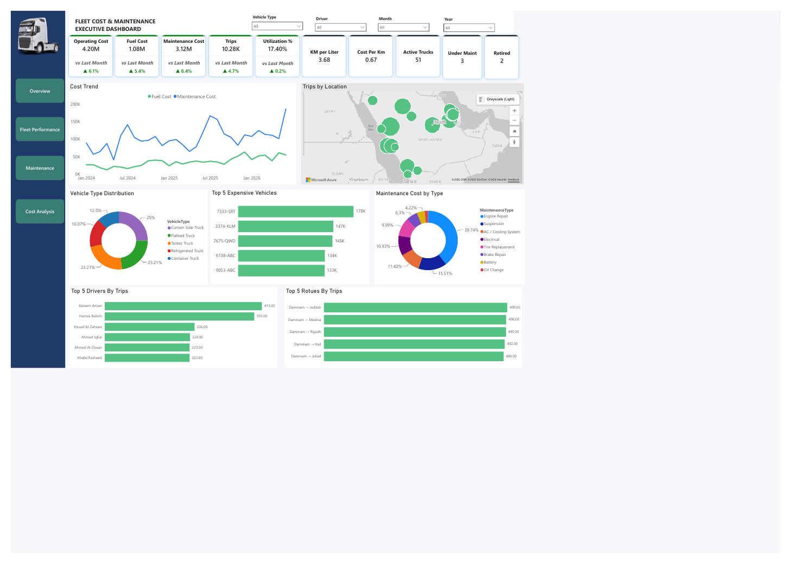

# Fleet Cost & Maintenance Dashboard

Executive Power BI dashboard tracking fleet operating cost, fuel vs maintenance spend, utilization and the most expensive vehicles.

## What it shows
- Operating cost split into fuel and maintenance, with month-over-month variance
- KPIs: cost per km, km per liter, trips, utilization %, active / under-maintenance / retired trucks
- Top 5 most expensive vehicles, vehicle-type distribution and maintenance cost by type
- Includes an eight-month cost breakdown report and a dashboard build guide

## Files
- `Fleet Cost and Man.pbix`: Power BI report (open in Power BI Desktop)
- `Fleet Cost and Man.pdf`: exported PDF of the report
- `data/`: source data. Synthetic dataset (2024-2026) modelled on Saudi fleet seasonality and diesel price inflation. No real company data.

## Tools
Power BI, DAX, Power Query.

## Author
Asad Ullah, Data Analyst and Power BI Developer, Dammam, Saudi Arabia
[LinkedIn](https://linkedin.com/in/asadullah44) | [Portfolio](https://asadullah-the-analyst.netlify.app) | [GitHub](https://github.com/asadullah43)
